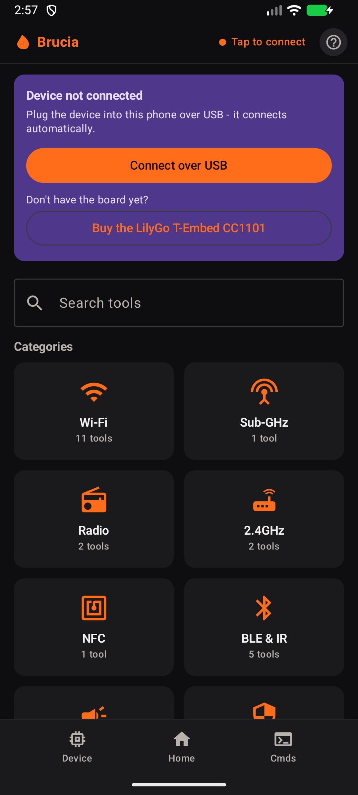
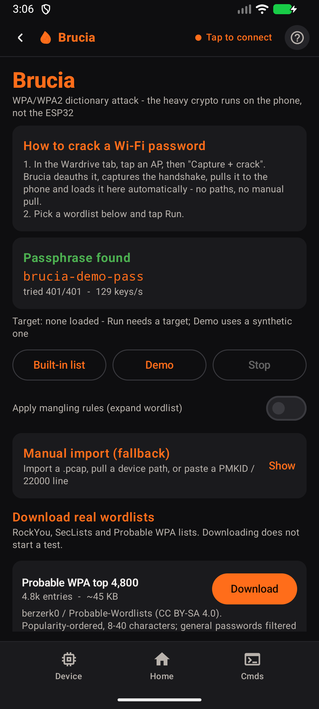
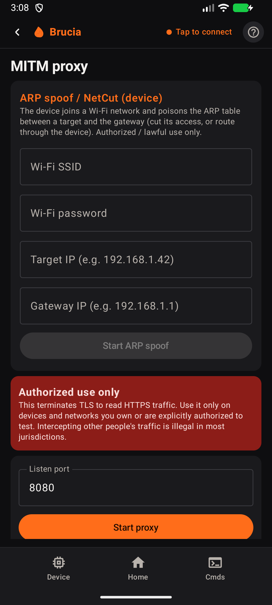

# Brucia

**WPA/WPA2 dictionary checks on your phone. MITM inspection with a GUI. GPS wardriving. PCAP analysis.**

Brucia pairs a native Android app with Bruce-derived ESP32 firmware. The phone runs
password-candidate checks, the HTTP/HTTPS inspection proxy, maps and capture analysis;
the ESP32 handles its radios and peripherals. Use a **LilyGO T-Embed CC1101**, an
Android phone with USB host/OTG and a USB data cable. The firmware also works standalone.

**[Download the latest APK + firmware](https://github.com/1vcian/Brucia/releases/latest)** ·
[Get started](wiki/Getting-Started.md) · [Wiki](https://1vcian.me/Brucia/wiki/) ·
[Tutorials](wiki/Tutorials.md) · [Changelog](CHANGELOG.md)

> **Authorized security research only:** use Brucia on equipment you own or have explicit
> permission to test. See [SECURITY.md](SECURITY.md) for scope, limitations and reporting.

  
  
  

*Actual 0.1.13 app screens on an Android emulator. The demo uses a synthetic handshake;
no board or network capture is shown.* [Watch the app walkthroughs](wiki/Tutorials.md).

## What you can do today

| Workflow | What runs on the phone |
|---|---|
| **WPA/WPA2 dictionary recovery** | Check candidates against imported handshakes or PMKIDs; manage wordlists, see progress and stop the run. A built-in synthetic demo needs no device. |
| **MITM inspection** | Start a lab HTTP/HTTPS proxy, inspect requests and responses, and export captured traffic. HTTPS needs a compatible client that trusts your configured CA; certificate pinning can prevent inspection. |
| **GPS wardriving** | Combine device Wi-Fi observations with phone GPS, map tracks and access points, and export WiGLE CSV, KML or GPX. |
| **PCAP analysis** | Open capture files, browse packet summaries and protocol details, and export results. |

Built on [Bruce](https://github.com/BruceDevices/firmware), with a Kotlin + Compose app.
**The phone is the brain. The ESP32 is the antenna.**

*Let your phone burn, so your ESP32 doesn't.*

## One cable. Plenty to explore.

| Workspace | What's inside |
|---|---|
| **Wi-Fi & BLE** | Scanners, phone GPS maps, saved observations, place comparisons and exports. |
| **Sub-GHz** | Capture, waveforms, saved signals, replay, spectrum and De Bruijn planning. |
| **Infrared & NFC** | Remote catalog, signal learning, TV-B-Gone, tag tools and NDEF. |
| **Audio lab** | Spectrum, waterfall, oscilloscope, DTMF, SSTV and an RTTTL composer. |
| **Files & automation** | Device file browser, JavaScript, saved macros and session reports. |
| **Device desk** | Screen mirror, navigation, settings, diagnostics and USB updates. |

There are dedicated controls for **WPA/WPA2 dictionary attacks**, **MIFARE dictionary
checks**, **De Bruijn**, **BLE spam**, **Wi-Fi beacon spam/deauth** and **IR power spam**.
Network tools include portals and a phone-hosted HTTP/HTTPS inspection proxy;
HTTPS inspection requires a compatible client that trusts the configured CA.
Use active tools on equipment you own or have permission to test.

[Explore all tools](wiki/Features.md) · [Check your hardware](docs/HARDWARE_CAPABILITIES.md)

## Get connected

1. Download the Android APK and firmware for your exact board from the same
   [release](https://github.com/1vcian/Brucia/releases/latest).
2. Flash the T-Embed CC1101 with the [web flasher](https://1vcian.me/Brucia/) in desktop
   Chrome or Edge, using a USB data cable.
3. Install the APK, connect the board to your phone over USB and grant USB access.
4. Enter **Brucia** on the device. Open device information or the file browser to
   check the connection.

The app also includes a USB firmware updater. For installation, upgrades and recovery,
follow [Getting Started](wiki/Getting-Started.md).

## What the phone brings

Analyze audio, keep a history of Wi-Fi/BLE observations, work with captures and wordlists,
and carry your files, maps and reports in one place. Shared controls connect those tools
to the device's radios and peripherals.

Bruce already offers dictionary recovery and radio tools; Flipper has its own mobile
app and community ecosystem. Our [comparison](docs/COMPARISON.md) explains the differences
and includes reproducible processing benchmarks, clearly labelled by hardware.

## Current limits

- The MITM proxy is a **single-user lab capture proxy**, not a production or high-concurrency
  proxy. It uses 4 core workers (up to 8) and a queue of 32 connections. Slow clients or
  idle tunnels can occupy workers until the 60-second client read timeout; excess connections
  are closed when capacity is exhausted. Queue time can add to the delay; this is a read
  timeout, not a maximum connection lifetime.
- Hardware support and test coverage vary by board and peripheral. Optional LoRa, NRF24,
  FM and Ethernet features need compatible modules. Command success is not proof that a
  receiver reacted; BLE advertising does not guarantee a popup on a Mac or phone.
- Releases and automated tests are available; [TESTS.md](TESTS.md) distinguishes software
  results from the hardware checks still open.

## Built together

You don't need a new feature to make Brucia better. Try a guide, reproduce a bug,
improve a screen, document a peripheral or contribute a focused fix.

| Want to help? | Start here |
|---|---|
| Something broke | [Report a bug](https://github.com/1vcian/Brucia/issues/new?template=bug_report.md) with versions and steps. |
| Have an idea | [Suggest a feature](https://github.com/1vcian/Brucia/issues/new?template=feature_request.md) and describe the workflow. |
| Improve the project | [Contribution guide](CONTRIBUTING.md), [source map](wiki/Architecture.md) and [roadmap](ROADMAP.md). |
| Try your hardware | [Functional checklist](docs/APP_CONTROLS_CHECKLIST.md) and [recorded results](TESTS.md). |

## What's next

The priority is physical acceptance of the released app/firmware pair, followed by focused
reliability fixes and community-tested peripherals. See the [roadmap](ROADMAP.md),
[functional checklist](docs/APP_CONTROLS_CHECKLIST.md) and [contribution guide](CONTRIBUTING.md).

## Credits & license

Brucia is a separate project built on the work of **Bruce's authors and contributors**.
Firmware and app are **AGPL-3.0**; see [LICENSE](LICENSE), [NOTICE](NOTICE) and
[third-party credits](THIRD_PARTY.md). Release source lives at the matching Git tag.
For sensitive vulnerability reports, see [SECURITY.md](SECURITY.md).

## Keep the fire going

Brucia is free software. Contributions, useful bug reports and shared test results
all help. You can also support development through
[GitHub Sponsors](https://github.com/sponsors/1vcian) or
[buy me a coffee](https://buymeacoffee.com/1vcian).

Support with Bitcoin or Monero

| | Address |
|---|---|
|  | **Bitcoin** `bc1qee8a06x886ng8ce6qy84l6u6x54jnjsesgqym7` |
|  | **Monero** `46qDyafRkn1at3E2GMwuESBeqzpt74xE8S2kjPe35EUyKiS57Ho7cLB1vD2zH4hPmjYcYzWWxSSLZAYB5Hp1yDFrKnPWkR7` |

