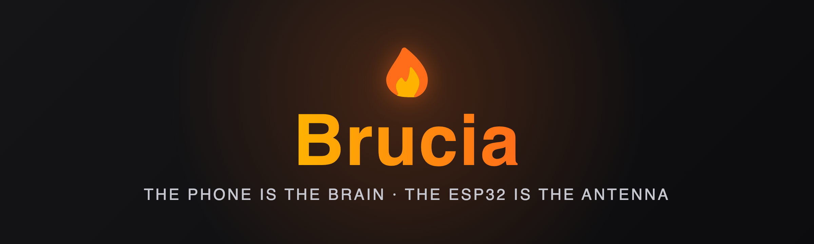
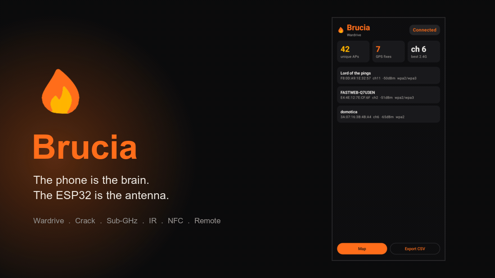
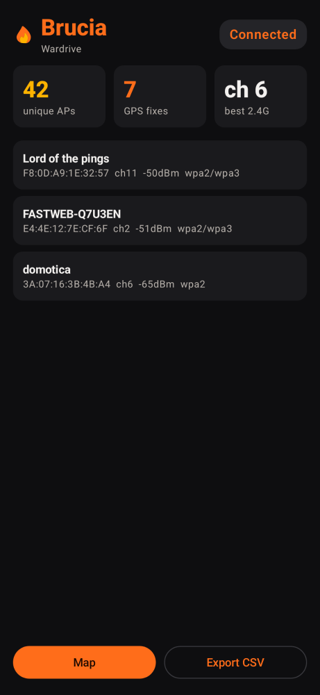
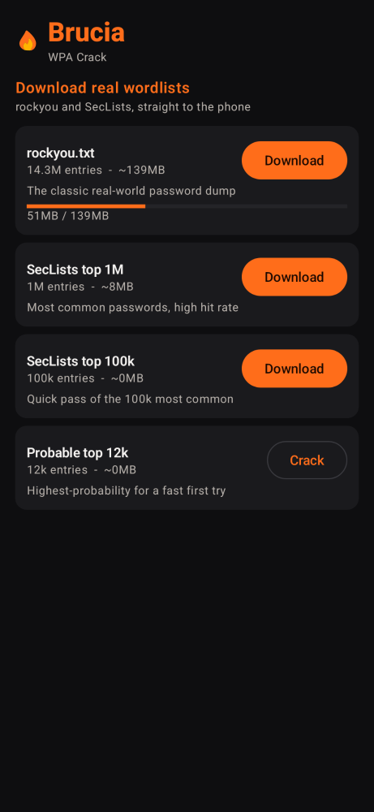
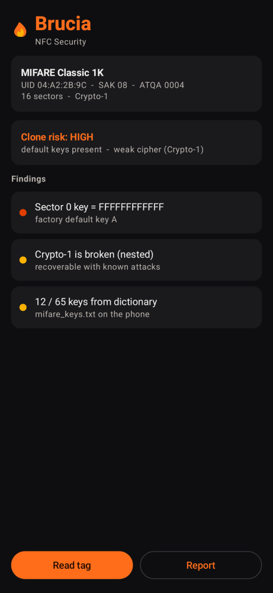
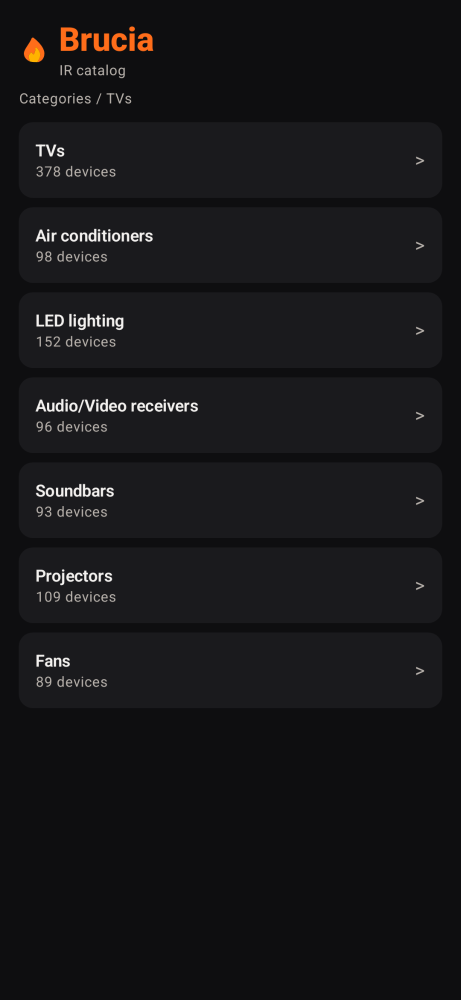

<div align="center">



**The phone is the brain. The ESP32 is the antenna.**

### _Let your phone burn, so your ESP32 doesn't._

An open-source platform for low-cost security research: cheap ESP32 hardware as a
radio/sensor front-end, a native Android app as the compute, storage and GUI.

> **Brucia** means *"it burns"* in Italian. It's a phonetic nod to the original *Bruce* firmware,
> but with a completely inverted architecture: let your Android CPU burn through the heavy DSP, UI
> and WPA-cracking tasks, so your little ESP32 doesn't literally *brucia*.

> **Brucia started from [Bruce](https://github.com/BruceDevices/firmware)** - it is a
> fork/derivative of the Bruce firmware, and it keeps and credits that work (AGPL-3.0).
> Huge thanks to the Bruce project and its authors.

[](LICENSE)
[](#hardware)
[](#the-app)
[](TESTS.md)
[](#principles)

[Usage](docs/USAGE.md) ·
[Comparison](docs/COMPARISON.md) ·
[Hardware proof](docs/HARDWARE_VERIFICATION.md) ·
[Protocol](proto/PROTOCOL.md) ·
[Code map](src/companion/README.md)

<br>

<a href="https://s.click.aliexpress.com/e/_c33qeCLh" target="_blank" rel="noopener sponsored"></a>
<a href="https://github.com/sponsors/1vcian" target="_blank"></a>
<a href="https://www.buymeacoffee.com/1vcian" target="_blank"></a>
<a href="#crypto"></a>
<a href="#crypto"></a>

</div>

> **For authorized security research and education only.** You are responsible for
> complying with all applicable laws and for only testing systems you own or are
> explicitly permitted to test.

> **Project status - early development, honest disclaimer.** Brucia is young and moving fast.
> Build and test evidence is recorded in the [test evidence](TESTS.md);
> it does not establish hardware coverage for every supported board. Phone-side pure logic (WPA/PMKID cracking, OOK/rolling-code
> decode, MIFARE key checks, OUI lookup, protocol, ...) has **unit-test coverage**. But most of the
> **radio/hardware features have not yet been verified end-to-end on real hardware** - they are
> implemented, not proven. Treat any capability as "builds, pending on-device verification" until
> it is checked off in [TESTS.md](TESTS.md) / [test evidence](TESTS.md). Use it on hardware
> you can afford to re-flash, and don't rely on a feature until you've tested it yourself.

---

## Brucia vs Flipper Zero vs Bruce

Brucia pairs Bruce-derived firmware with an Android workspace for analysis,
storage, maps and device control. The reference board is the **LilyGO T-Embed
CC1101**; supported operations depend on both its hardware and the current driver.

| Area | Current distinction |
|---|---|
| Wi-Fi / BLE | Native on the ESP32; the phone adds analysis, GPS and a larger UI. |
| Sub-GHz / IR | Stock radios are present. Decoder and replay support must be checked per protocol; the CC1101 is not an IQ SDR. |
| NFC | Stock PN532, with controller-specific limits. It is not full Flipper NFC emulation parity. |
| LF RFID / iButton | Flipper includes dedicated hardware; stock T-Embed does not. These actions remain unavailable without compatible interfaces. |
| Audio | DSP, waterfall, SSTV RX/TX, DTMF, scope and melody composition already exist; final physical verification is pending. |
| Research workflow | Native Android companion; Flipper also has an official mobile app. No universal novelty claim. |
| Infinite battery · SERIAL-KILLER | The meme stays. USB can draw power from your phone; both batteries remain finite. |

Three representative firmware environments build; this does not verify all configured
boards or all physical functions. See [tests](TESTS.md) and the
[full comparison and primary sources](docs/COMPARISON.md).

---

## What is Brucia?

**Brucia** is a derivative of the [Bruce](https://github.com/BruceDevices/firmware)
ESP32 firmware, extended so the device becomes a **radio/sensor front-end** driven by
a **native Android companion app** that provides the heavy computation, large storage
and a full-size touch GUI.

Bruce already lets a phone *remote-control* the device, but **all computation stays on
the ESP32** - little RAM/CPU, a tiny screen, and an external GPS module is needed for
wardriving. Brucia flips this:

```
   ESP32-S3 (Brucia firmware)                Android (Brucia app)
   ──────────────────────────                ────────────────────
   Radio / sensor FRONT-END      <=USB=>      Compute + storage + GUI
   - capture / transmit                       - decode / crypto / analysis
   - realtime timing                          - Room DB, big datasets
   - raw-data framing + stream                - GPS, offline maps, viz
         │                                           │
         └──────── Transport (abstract) ─────────────┘
                   USB-CDC  |  Wi-Fi  |  BLE
                        └── one Protocol ──┘
```

Cheap hardware (~$30-50) plus the power and UX of a phone you already own.

## Verified on real hardware

Brucia runs end-to-end on a **LilyGo T-Embed CC1101 (ESP32-S3)** today: capability
handshake, live Wi-Fi wardrive, live BLE scan and CLI command routing - all streamed
over USB-CDC to the phone. See [the hardware proof](docs/HARDWARE_VERIFICATION.md).

<div align="center">

<br><em>Real APs streamed from the device over USB; the phone adds GPS, dedup, vendor lookup and WiGLE/KML export.</em>
<br><br>

<br><em>The Android app (flame theme), rendered from the real Compose UI.</em>
</div>

## Features

Grouped by domain. Everything below is driven from the phone over USB unless noted,
and each page is shown or disabled by **runtime module detection**: on connect the
device reports which hardware it actually has (cc1101, nfc, nrf24, fm, ir, mic,
speaker) and the app enables only the matching pages.

**Wi-Fi** - wardrive (phone GPS, Room storage, dedup, offline map, CSV/KML/GPX export,
direct WiGLE upload); WPA handshake + PMKID capture pulled over USB and cracked on the
phone (rockyou / SecLists, mangling rules, hashcat 22000/16800); deauth, station
sniffer, probe-request profiling, beacon spam; monitor mode (raw 802.11 streamed to the
phone as a pcap for Wireshark + PSK decrypt); ARP-spoof MITM and an on-phone HTTPS
intercept proxy (Brucia CA + per-host leaf certs, full decrypt, transaction viewer;
HSTS/pinned hosts fall back to metadata-only tunnels).

**Sub-GHz (CC1101)** - raw OOK capture to CSV; rolling-code-aware decoding on the phone
(Princeton/CAME/NICE/Holtek + KeeLoq fixed/rolling); `.sub` import/export; De Bruijn
brute force; replay; spectrum-sweep waterfall; jammer (authorized); radio config
(frequency/modulation/bandwidth/data-rate).

**NFC / RFID** - read / clone / emulate / write / NDEF; MIFARE key-dictionary attack;
NDEF push (tap-to-send); EMV read (masked PAN/expiry/scheme); magic/Gen1A UID write.

**IR** - universal catalog (1648 models), learn/RX, TV-B-Gone, raw replay.

**BLE** - scan; GATT explorer (services/characteristics/values); BadBLE (Ducky over
BLE); spam hub (Apple / Android Fast Pair / Windows Swift Pair / Samsung).

**NRF24 (2.4 GHz add-on)** - scanner, ESB sniffer, jammer, MouseJack; gated on the
add-on module being attached.

**Tools** - live mic spectrum, speaker tone/play, mic record, optional iButton interfaces,
clock/RTC sync, ESP-NOW send, on-device JavaScript (BruceJS) run from the phone, Console
CLI passthrough, file manager, and a live remote screen mirror with D-pad navigation. A
platform-organized **spam hub** (Apple/iOS/Mac, Android, Windows, Samsung, Wi-Fi, All)
lets you pick the target and have the app pick the transport. FM audio TX is implemented
but gated off on this board (no Si4713; the module reports absent).

**Offload & housekeeping** - session report export (Markdown), OSINT / OUI vendor
enrichment and heuristic insights; in-app updates (app OTA self-update plus device
firmware update over USB via esptool-over-USB).

## The app

The device captures/transmits; the phone does the heavy work. A home dashboard, bottom
navigation and a persistent connection/battery status bar tie the screens together, and
every page is gated per detected hardware.

| Screen | What the phone adds on top of the device |
|-----|------------------------------------------|
| **Wardrive** | Live Wi-Fi AP stream, GPS tagging, dedup, RSSI-weighted position estimate, offline map (osmdroid), analytics (encryption/channel/vendor, best 2.4 GHz channel, security findings), IEEE OUI lookup (40k), WiGLE CSV / KML export. |
| **Crack** | Full WPA toolkit: pull a `.pcap` from the device SD over USB (or import one), crack WPA handshakes and PMKID (PBKDF2 / PTK / MIC) with several built-in dictionaries (common WPA, numeric/date, keyboard walks, Italian, router defaults) plus a rockyou-scale import manager, hashcat-style mangling rules and keys/s, plus hashcat 22000 import/export. Impossible on Flipper/Bruce alone. |
| **NFC** | Read/emulate/clone a tag; phone-side security analysis (MIFARE Classic/Crypto-1, Ultralight/NTAG, clone-risk, 65+ known MIFARE default keys). |
| **IR** | Bundled universal catalog (Flipper-IRDB subset) with search, import any `.ir`, learn a remote, transmit via the device. |
| **RF (Sub-GHz)** | Capture raw OOK timings on the device, decode on the phone (Princeton/PT2262/EV1527), encode and replay. |
| **BLE** | Scan on the device; list, dedup and resolve vendors on the phone. |
| **BadUSB** | Unlimited DuckyScript library on the phone (browse, view, copy); execute via BadBLE / standalone. |
| **Device** | Info, free memory, uptime, I2C scan, sleep/reboot. |
| **Console** | Run any Bruce CLI command from the phone and see its output - the full device feature set, exposed through the phone. |
| **Remote** | Full remote control: a D-pad drives the real device UI and the device screen is mirrored live in the app, so every standalone Bruce feature (Evil Portal, Karma, Beacon, Sniffer, ...) is reachable from the phone. |

Full walkthrough in [docs/USAGE.md](docs/USAGE.md).

### Compatibility with Bruce

The app exposes dedicated tools and a remote navigation path for Bruce-derived functions.
Remote reachability is not evidence that every menu action has passed acceptance:

- **Native offload screens** for every module the device reports - Wi-Fi (wardrive,
  deauth, handshake/PMKID capture, sniffer, monitor mode), BLE (scan, GATT, spam hub),
  Sub-GHz (capture, decode, De Bruijn, spectrum, replay), IR, NFC and the NRF24 add-on -
  plus **Tools**, a **File manager**, a **Console** (every CLI command, grouped) and
  **battery / lite mode**.
- **Remote control** (the **Remote** tab) drives the real device UI - a D-pad sends `nav`
  and the device screen is mirrored live - so any remaining standalone feature (Evil
  Portal, Karma, Sniffer, Reverse Shell, Scripts, ...) is operable from the phone.
- **Hardware scope:** pages are enabled by runtime module detection. FM (Si4713) and LoRa
  are not present on the T-Embed CC1101, so those pages report the module absent; NRF24 is
  an optional add-on and its page enables when the module is attached.

### Design

A single coherent flame theme across every screen (dark, ember/amber accents).
These are the **real Compose UI**, rendered on the JVM (Paparazzi) - not mockups.

<div align="center">



</div>

<div align="center"><em>Real wordlists (rockyou, SecLists) download straight to the phone - a real cracking tool, not a token list.</em></div>

<div align="center">

</div>

<div align="center"><em>Universal IR catalog (1600+ models, 800+ brands) browsed by category -> brand -> model.</em></div>

## Get the hardware

Brucia's reference board is the **LilyGo T-Embed CC1101** (ESP32-S3, Sub-1 GHz CC1101, optional
PN532 NFC, built-in 1300mAh battery). If you do not own one yet:

> **LILYGO® T-Embed CC1101** - ESP32-S3 low-power Sub-1 GHz RF transceiver + PN532 NFC/RFID + LCD, 1300mAh battery.
> **~EUR 77.69** - [Buy on AliExpress](https://s.click.aliexpress.com/e/_c33qeCLh)

*(AliExpress affiliate link - it costs you nothing extra and helps fund the project. Any board on
the [supported list](ROADMAP.md) works; this is just the one Brucia is verified on.)*

## Quick start

**1. Flash the firmware** (pick one)

- **Browser** (easiest): open **https://1vcian.me/BruciaDev/** in Chrome/Edge, plug in the
  T-Embed CC1101 with a *data* USB-C cable, click *Connect & Flash*.
- **From source**: build with `python3 tools/build_firmware.py -e lilygo-t-embed-cc1101`,
  then `pio run -e lilygo-t-embed-cc1101 -t upload`. Prerequisites and exact steps:
  [CONTRIBUTING.md](CONTRIBUTING.md#build--test).

**2. Install the app** - download the APK from
[Releases](https://github.com/1vcian/BruciaDev/releases), or build it:
`cd android && ./gradlew :app:assembleDebug` (JDK 17-23 and Android SDK 35; see
[CONTRIBUTING.md](CONTRIBUTING.md#build--test)).

**3. Connect** - plug the device into the phone and open the app. The device switches into
companion mode and the app links up automatically; if it doesn't, tap **Connect over USB**.

For how Brucia compares to Flipper Zero and Bruce, see the [feature comparison](docs/COMPARISON.md).

## Principles

- **Superset of Bruce.** Every Bruce feature keeps working. With no phone connected,
  the device is still a full Bruce (standalone mode). Companion mode is strictly additive.
- **Hardware boundary.** Radio/peripheral work stays on the ESP; compute, memory, UI and
  geolocation move to the phone.
- **100% free and open.** Firmware and app are both AGPL-3.0. No ads, no paid tiers,
  no telemetry.
- **Private and local.** Everything runs on your phone and the device - no accounts, no
  analytics, no tracking; nothing is collected or stored on any server of ours, and your
  captures stay on your phone. Brucia uses the internet only to download databases you choose
  (e.g. wordlists) and to check for updates - plus any export you trigger yourself (e.g. WiGLE).
- **Complementary, not a takeover.** The [official Bruce app](https://github.com/BruceDevices/App)
  *controls* the device; Brucia *offloads computation* to the phone. Brucia credits the
  original project and aims to upstream the firmware hooks.

## Repository layout

| Path | What |
|------|------|
| *(root)* | Fork of Bruce firmware (AGPL): `src/`, `platformio.ini`, boards. Companion code in `src/companion/`. |
| `android/` | Native Android app (Kotlin + Jetpack Compose). |
| `proto/` | The [companion wire protocol](proto/PROTOCOL.md) - single source of truth for both sides. |
| `docs/` | [Usage](docs/USAGE.md), [comparison](docs/COMPARISON.md), [hardware proof](docs/HARDWARE_VERIFICATION.md), and the browser flasher (GitHub Pages). |
| `tools/` | Host-side protocol test clients (`companion_test.py`, mock device, e2e). |
| [Firmware module map](src/companion/README.md) | Where Brucia hooks into the existing Bruce code. |

## Documentation

- [Project wiki](https://github.com/1vcian/BruciaDev/wiki) - getting started, features, architecture, protocol, building, FAQ
- [test evidence](TESTS.md) - current verification evidence and pending acceptance
- [SECURITY.md](SECURITY.md) - authorized-use policy and responsible disclosure
- [docs/USAGE.md](docs/USAGE.md) - flash, connect, and use every tab
- [docs/COMPARISON.md](docs/COMPARISON.md) - Flipper Zero vs Bruce vs Brucia
- [docs/HARDWARE_VERIFICATION.md](docs/HARDWARE_VERIFICATION.md) - proof it runs on real hardware
- [ARCHITECTURE.md](ARCHITECTURE.md) - the split design and how the layers fit
- [proto/PROTOCOL.md](proto/PROTOCOL.md) - the companion wire protocol
- [Firmware module map](src/companion/README.md) - integration points into Bruce
- [ROADMAP.md](ROADMAP.md) - what works, what is next, where help is wanted
- [CONTRIBUTING.md](CONTRIBUTING.md) - build, rules, and how to add a module
- [CHANGELOG.md](CHANGELOG.md) - release history

## Contributing

Contributions are welcome - especially additional [transports](ROADMAP.md)
(Wi-Fi/BLE), translations, and new modules.
Start with [CONTRIBUTING.md](CONTRIBUTING.md) and [ARCHITECTURE.md](ARCHITECTURE.md);
the [roadmap](ROADMAP.md) marks good first tasks.

## License

[AGPL-3.0](LICENSE). Derivative of Bruce; see [`NOTICE`](NOTICE) and
[`THIRD_PARTY.md`](THIRD_PARTY.md).

## Support

Brucia is free. If it helps you, you can optionally sponsor it via
[GitHub Sponsors](https://github.com/sponsors/1vcian) or
[buy me a coffee](https://buymeacoffee.com/1vcian).

### Crypto

| | Address |
|---|---|
|  | **Bitcoin**<br>`bc1qee8a06x886ng8ce6qy84l6u6x54jnjsesgqym7` |
|  | **Monero**<br>`46qDyafRkn1at3E2GMwuESBeqzpt74xE8S2kjPe35EUyKiS57Ho7cLB1vD2zH4hPmjYcYzWWxSSLZAYB5Hp1yDFrKnPWkR7` |
