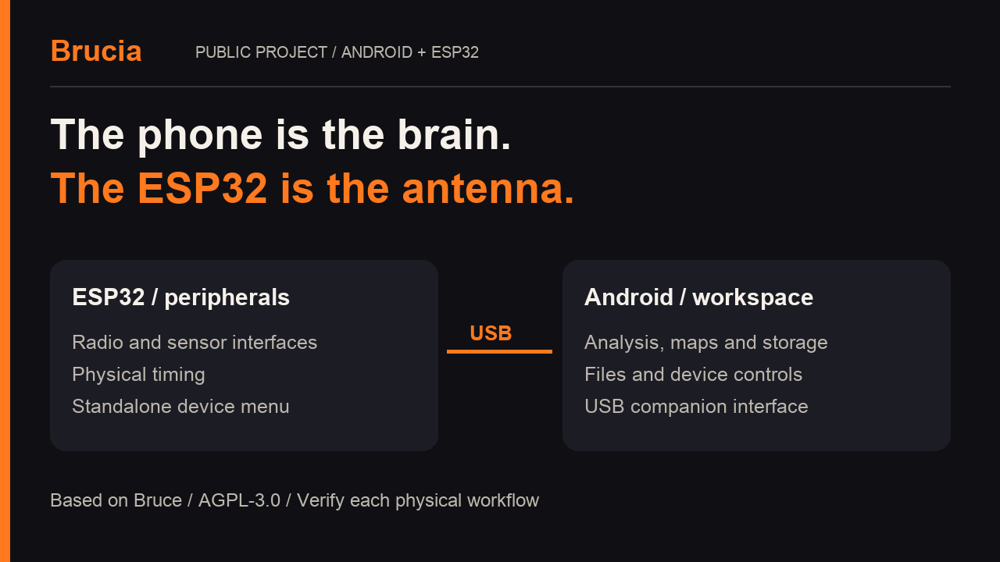
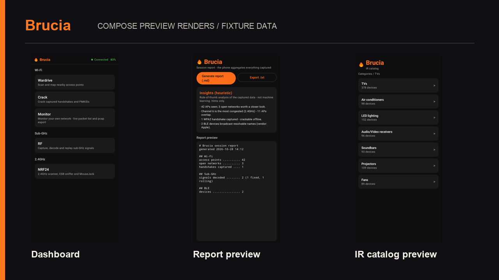

**The phone is the brain. The ESP32 is the antenna.**

*Let your phone burn, so your ESP32 doesn't.*

[Download](https://github.com/1vcian/Brucia/releases/latest) · [Get started](wiki/Getting-Started.md) ·
[Wiki](https://1vcian.me/Brucia/wiki/) · [Tutorials](wiki/Tutorials.md) · [Contribute](CONTRIBUTING.md)

Brucia turns an Android phone and an ESP32 into a shared workspace for radio,
security research and hardware experiments. The device handles peripherals and timing;
the phone brings the screen, processing, maps and storage.

Built on [Bruce](https://github.com/BruceDevices/firmware), with a native Kotlin +
Compose app. Start with a **LilyGO T-Embed CC1101**, an Android phone with USB host/OTG
and a USB data cable. The firmware also works from its own menus.

## One cable. Plenty to explore.

| Workspace | What's inside |
|---|---|
| **Wi-Fi & BLE** | Scanners, phone GPS maps, saved observations, place comparisons and exports. |
| **Sub-GHz** | Capture, waveforms, saved signals, replay, spectrum and De Bruijn planning. |
| **Infrared & NFC** | Remote catalog, signal learning, TV-B-Gone, tag tools and NDEF. |
| **Audio lab** | Spectrum, waterfall, oscilloscope, DTMF, SSTV and an RTTTL composer. |
| **Files & automation** | Device file browser, JavaScript, saved macros and session reports. |
| **Device desk** | Screen mirror, navigation, settings, diagnostics and USB updates. |

There are dedicated controls for **WPA/WPA2 dictionary attacks**, **MIFARE dictionary
checks**, **De Bruijn**, **BLE spam**, **Wi-Fi beacon spam/deauth** and **IR power spam**.
Network tools include portals and a phone-hosted HTTP/HTTPS inspection proxy;
HTTPS inspection requires a compatible client that trusts the configured CA.
Use active tools on equipment you own or have permission to test.

[Explore all tools](wiki/Features.md) · [Check your hardware](docs/HARDWARE_CAPABILITIES.md)

## Get connected

1. Download the Android APK and firmware for your exact board from the same
   [release](https://github.com/1vcian/Brucia/releases/latest).
2. Flash the T-Embed CC1101 with the [web flasher](https://1vcian.me/Brucia/) in desktop
   Chrome or Edge, using a USB data cable.
3. Install the APK, connect the board to your phone over USB and grant USB access.
4. Enter **Brucia** on the device. Open device information or the file browser to
   check the connection.

The app also includes a USB firmware updater. For installation, upgrades and recovery,
follow [Getting Started](wiki/Getting-Started.md).

## Take a look

*App preview renders with sample data.* Browse the [illustrated video guides](wiki/Tutorials.md)
for first connection, files, updates, observations and audio.

## What the phone brings

Analyze audio, keep a history of Wi-Fi/BLE observations, work with captures and wordlists,
and carry your files, maps and reports in one place. Shared controls connect those tools
to the device's radios and peripherals.

Bruce already offers dictionary recovery and radio tools; Flipper has its own mobile
app and community ecosystem. Our [comparison](docs/COMPARISON.md) explains the differences
and includes reproducible processing benchmarks, clearly labelled by hardware.

## Built together

You don't need a new feature to make Brucia better. Try a guide, reproduce a bug,
improve a screen, document a peripheral or contribute a focused fix.

| Want to help? | Start here |
|---|---|
| Something broke | [Report a bug](https://github.com/1vcian/Brucia/issues/new?template=bug_report.md) with versions and steps. |
| Have an idea | [Suggest a feature](https://github.com/1vcian/Brucia/issues/new?template=feature_request.md) and describe the workflow. |
| Improve the project | [Contribution guide](CONTRIBUTING.md), [source map](wiki/Architecture.md) and [roadmap](ROADMAP.md). |
| Try your hardware | [Functional checklist](docs/APP_CONTROLS_CHECKLIST.md) and [recorded results](TESTS.md). |

Brucia is actively developed. Support varies by board, peripheral and operation;
[TESTS.md](TESTS.md) tracks what has actually been checked. Optional modules such as
LoRa, NRF24, FM and Ethernet need compatible hardware. BLE advertisements do not
promise an OS popup, and command success alone does not confirm a receiver response.

## Credits & license

Brucia is a separate project built on the work of **Bruce's authors and contributors**.
Firmware and app are **AGPL-3.0**; see [LICENSE](LICENSE), [NOTICE](NOTICE) and
[third-party credits](THIRD_PARTY.md). Release source lives at the matching Git tag.
For sensitive vulnerability reports, see [SECURITY.md](SECURITY.md).

## Keep the fire going

Brucia is free software. Contributions, useful bug reports and shared test results
all help. You can also support development through
[GitHub Sponsors](https://github.com/sponsors/1vcian) or
[buy me a coffee](https://buymeacoffee.com/1vcian).

Support with Bitcoin or Monero

| | Address |
|---|---|
|  | **Bitcoin** `bc1qee8a06x886ng8ce6qy84l6u6x54jnjsesgqym7` |
|  | **Monero** `46qDyafRkn1at3E2GMwuESBeqzpt74xE8S2kjPe35EUyKiS57Ho7cLB1vD2zH4hPmjYcYzWWxSSLZAYB5Hp1yDFrKnPWkR7` |

