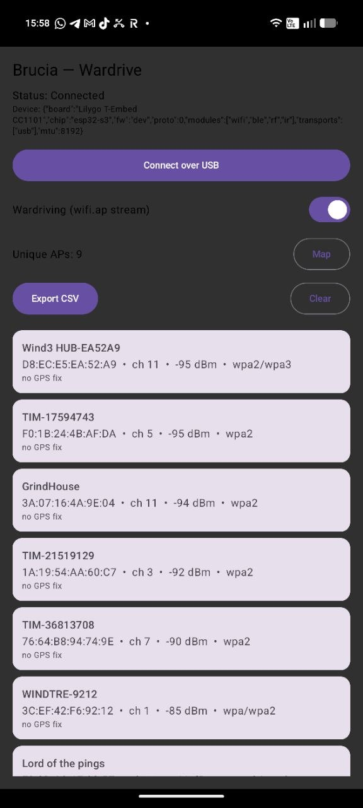

# Hardware verification

Brucia has been verified end-to-end on real hardware: a **LilyGo T-Embed CC1101
(ESP32-S3)** flashed with the Brucia firmware, driven over USB-CDC by the companion
protocol from a host.

Device: tap `Brucia` on the home screen, then run `tools/companion_test.py` (or the Android app).

## Verified (2026-10-27)

```
=== BRUCIA LIVE HARDWARE VERIFICATION ===
[1] HELLO -> CAPS OK
    {"board":"Lilygo T-Embed CC1101","chip":"esp32-s3","fw":"dev","proto":0,
     "modules":["wifi","ble","rf","ir"],"transports":["usb"],"mtu":8192}
[2] PING -> PONG OK
[3] CMD 'wifi scan' -> ACK OK (CLI output captured and returned)
[4] SUB wifi.ap on -> live Wi-Fi AP stream   (7 unique APs in 8s)
[5] SUB ble.scan on -> live BLE scan stream  (19 devices in 6s)
```

Wi-Fi scan, BLE scan, PING/PONG, capability handshake and CLI command routing with
output capture all work over USB-CDC against the real device.

## Also verified on hardware (2026-10-27)

- **Remote control**: `nav` drives the real Bruce UI and `display start` streams the TFT
  draw-ops; real frames (WiFi/NRF24 menus) render in the app's mirror. "Everything Bruce
  does, from the app."
- **Flame theme**: on-device config reads `priColor=fb63, secColor=fd80, bgColor=0`
  (ember/amber on black) - verified via `storage read /bruce.conf`.
- **Battery**: CAPS and every PONG report `"battery"` (read live: 100%).
- **Lite mode**: `scr 0/1` (screen off/on) and `led 0/1` return `ok`, with auto-restore
  if the app disconnects.

Pending (need an AP you own / physical input): live deauth, BLE spam and handshake
capture against a real target, and the physical wheel feel.

## Live wardrive stream (real capture)

Each line is a `wifi.ap` EVENT streamed from the device to the host, deduplicated
by BSSID on the host side:

```
[NEW] F8:0D:A9:1E:32:57  ch 11  -50dBm  wpa2/wpa3  'Lord of the pings'
[NEW] E4:4E:12:7E:CF:6F  ch  2  -51dBm  wpa2/wpa3  'FASTWEB-Q7U3EN'
[NEW] 3A:07:16:3B:4B:A4  ch  6  -65dBm  wpa2       'domotica'
[NEW] 3C:EF:42:F6:92:12  ch  1  -79dBm  wpa/wpa2   'WINDTRE-9212'
[NEW] A8:29:48:68:9E:99  ch 10  -91dBm  wpa2       'TP-Link_9E99'
[NEW] D8:EC:E5:EA:52:A9  ch 11  -94dBm  wpa2/wpa3  'Wind3 HUB-EA52A9'
[NEW] 76:64:B8:94:74:9E  ch 10  -95dBm  wpa2       'TIM-36813708'
```

The host (phone) adds GPS tags, dedup, RSSI-weighted position estimates, vendor
lookup, analytics and WiGLE/KML export on top of this raw stream - none of which
the ESP32 does on its own.

The Android app during a live capture (real APs streamed over USB):



## Reproduce

```sh
# Flash
pio run -e lilygo-t-embed-cc1101 -t upload
# On the device: tap Brucia on the home screen
python3 tools/companion_test.py /dev/tty.usbmodemXXXX           # handshake + PING
python3 tools/companion_test.py /dev/tty.usbmodemXXXX --wardrive # live AP stream
```
